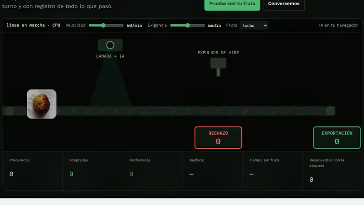
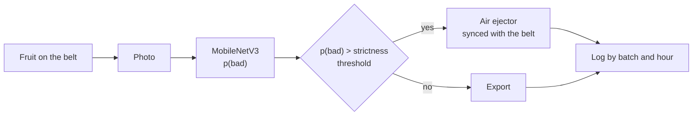

# AI Fruit Sorter

**An AI sorting line for packing houses: the camera looks at every fruit, the model decides good or bad and fires the ejector. No fatigue, consistent criteria, logged by batch and hour.**

[Español](README.md) · **English**

> The interface is in Spanish.

## The problem

Sorting on packing lines is manual. More bad fruit slips through late in the shift, each sorter applies their own criteria, and nothing records how much bad fruit arrived, from which grower or when.

## How it works

The **strictness threshold** is adjustable live: stricter rejects more borderline fruit, looser lets more through. It is the commercial decision each sorter makes today.

## Results

Classifier trained on 2,240 photos of 8 fruits, fresh and rotten, evaluated on **480 photos it never saw**:

| Metric | Result |
|---|---|
| Good/bad accuracy | 98.8 % |
| Good fruit rejected | 0 of 240 |
| Bad fruit passed | 6 of 240 |
| Time per fruit | ~3 ms |

**Limit:** these are photos of loose fruit on plain backgrounds, not an industrial line. A pilot fine-tunes on the client's line and compares against their sorters before touching the line.

## Files

| File | What it is |
|---|---|
| `index.html` | Animated line with camera, ejector and threshold; try-your-own-photo/camera mode. |
| `sel.js` | Preprocessing and ONNX inference. |
| `model.onnx` | MobileNetV3 classifier. |
| `frutas/`, `frutas.json` | Demo photos. |

## Licenses and credits

- Data: Sultana, N. et al. (2022), *An extensive dataset for successful recognition of fresh and rotten fruits*, Data in Brief 44, 108552, **CC BY 4.0**, via Project AgML.
- MobileNetV3 (torchvision, BSD) running on ONNX Runtime Web (MIT).

---

Personal project by **Julián Neira Nova**, electrical engineer with 10 years in mining operations · Servicio y Soluciones Tecnológicas DelaCruz SpA. Nothing here comes from clients or employers.
[Portfolio](https://jsnn15.github.io/) · [LinkedIn](https://www.linkedin.com/in/julian-neira-nova/) · [All tools](https://github.com/JSNN15)
