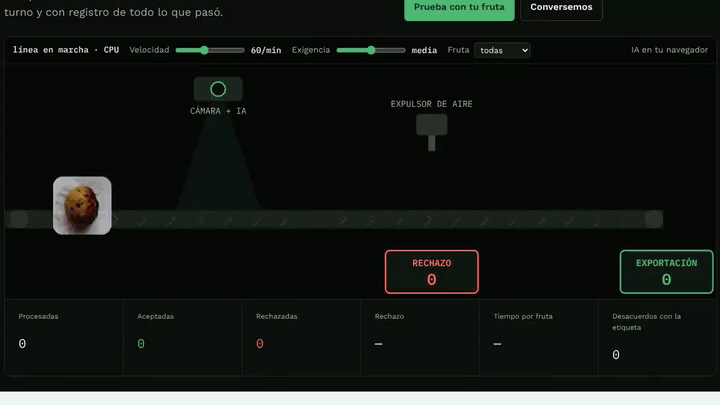
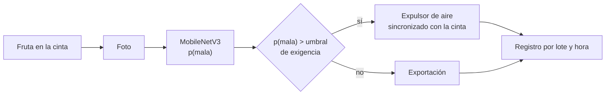

# Selector IA de fruta

**Una línea de selección con IA para plantas de embalaje: la cámara mira cada fruta, el modelo decide si está buena o mala y comanda el expulsor. Sin cansancio, con un criterio parejo y con registro por lote y hora.**

**Español** · [English](README.en.md)

## El problema

En la línea de embalaje la selección es manual. Al final del turno se escapa más fruta mala, cada persona descarta con su criterio y no queda registro de cuánta fruta mala llegó, de qué productor ni a qué hora.

## Cómo funciona

El **umbral de exigencia** se ajusta en vivo: más exigente descarta más fruta dudosa; menos exigente deja pasar más. Es la decisión comercial que hoy queda en cada seleccionador.

## Resultados

Clasificador entrenado con 2.240 fotos de 8 frutas, frescas y en mal estado, y evaluado con **480 fotos que nunca vio**:

| Medida | Resultado |
|---|---|
| Acierto bueno/malo | 98,8 % |
| Fruta buena descartada | 0 de 240 |
| Fruta mala que pasó | 6 de 240 |
| Tiempo por fruta | ~3 ms |

**Límite:** son fotos de fruta suelta sobre fondos simples, no de una línea industrial. En un piloto el modelo se ajusta con fotos de la línea del cliente y se compara con sus seleccionadores antes de tocar la línea.

## Archivos

| Archivo | Qué es |
|---|---|
| `index.html` | Línea animada con cámara, expulsor y umbral; modo para probar con foto o cámara propia. |
| `sel.js` | Preprocesamiento e inferencia ONNX. |
| `model.onnx` | Clasificador MobileNetV3. |
| `frutas/`, `frutas.json` | Fotos de la demo. |

## Licencias y créditos

- Datos: Sultana, N. y otros (2022), *An extensive dataset for successful recognition of fresh and rotten fruits*, Data in Brief 44, 108552, **CC BY 4.0**, vía Project AgML.
- Modelo MobileNetV3 (torchvision, BSD) ejecutado con ONNX Runtime Web (MIT).

---

Proyecto personal de **Julián Neira Nova**, ingeniero eléctrico con 10 años en faena · Servicio y Soluciones Tecnológicas DelaCruz SpA. Nada de lo publicado proviene de clientes ni de empleadores.
[Portafolio](https://jsnn15.github.io/) · [LinkedIn](https://www.linkedin.com/in/julian-neira-nova/) · [Todas las máquinas](https://github.com/JSNN15)
